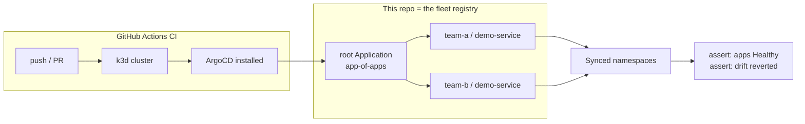

# gitops-fleet-demo

**ArgoCD app-of-apps on k3d — GitOps delivery proven in CI, free to run.**

No AWS bill. Every push spins up a throwaway k3d cluster in GitHub Actions, installs
ArgoCD, applies the app-of-apps root, and proves the whole GitOps promise:
**the repo is the only source of truth, and drift gets reverted automatically.**



## What it demonstrates

| Pattern | Where |
|---|---|
| **App-of-apps** — one root Application that spawns all others | `bootstrap/root.yaml` |
| **AppTeam lane** — a team can ship by editing only their values | `apps/team-*/...` |
| **Chart + values split** — shared chart, per-team overrides | `resources/chart`, `apps/team-*/values.yaml` |
| **Drift-revert** — ArgoCD undoes any manual kubectl change | `tests/drift.sh` + CI assert |
| **Trust-the-repo** — everything flows from Git; UI is read-only | CI stage "prove it" |

## Try it locally

```bash
# prerequisites: k3d, kubectl, argocd CLI
./scripts/up.sh          # k3d cluster + ArgoCD + root app
kubectl -n argocd get applications -w
./scripts/drift-demo.sh  # manually edit a deployment, watch ArgoCD revert it
./scripts/down.sh
```

## CI proof (GitHub Actions)

Every run:
1. Creates a k3d cluster
2. Installs ArgoCD
3. Applies `bootstrap/root.yaml`
4. Waits for team-a and team-b apps to reach `Healthy`
5. **Deliberately breaks a deployment** with kubectl
6. Asserts ArgoCD reverts it within the sync window ✅

See [.github/workflows/gitops-demo.yml](.github/workflows/gitops-demo.yml)

## Why this exists

The same delivery pattern I run at enterprise scale (ArgoCD control-planes managing
multi-tenant data-plane clusters where app teams ship via PRs), boiled down to something
you can run for free in CI.

## License

MIT
